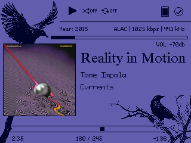
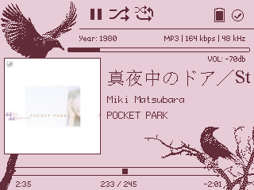
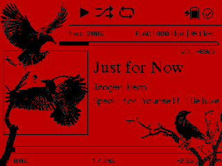
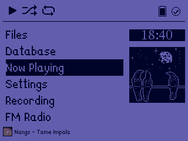
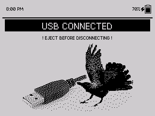

# crowPod

Version 1.0

Last Update: 06/25/2026

License: CC-BY-SA 3.0

By: Monica G.

Description: Crow theme!! All pixel art is by me. The picture on the menu changes according to the time of day (changes at 8 AM, 2 PM, and 6 PM). 

Code based on: bunnyPod by me! which are based on SNARTY by Simon Anden and BONES by Chuck Largo! Credits to J. Adler for ProFont-CJK. Other fonts used are Bitstream Cyberbit and LanaPixel by eishiya. Also inspired by RatPod by Jannis Bolzern! 

Caw caw! (made with whimsy for Sienna <3)

## fonts
- LanaPixel
- Cyberbit

## wps screenshots

## menu screenshot

## usb screenshot

